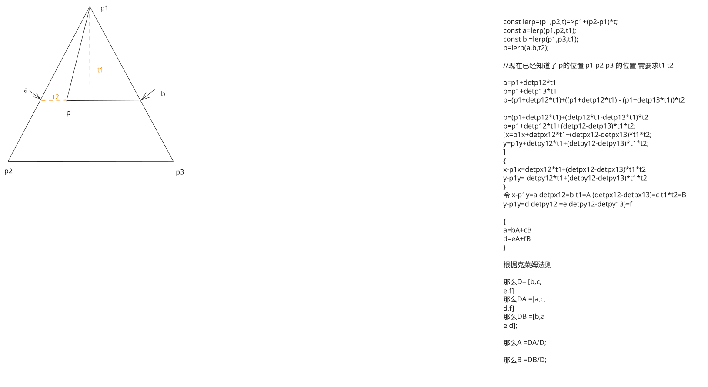

##  1. 原始方程组

给定如下参数化方程（常见于图形插值、三角形重心坐标计算）：

$$\begin{cases} x - x_1 = \Delta x_{12} t_1 + (\Delta x_{13} - \Delta x_{12}) t_1 t_2 \\ y - y_1 = \Delta y_{12} t_1 + (\Delta y_{13} - \Delta y_{12}) t_1 t_2 \end{cases}$$

## 2. 解题思路：线性化与代换

为了简化计算，我们引入中间变量：

- 设 $A = t_1$
    
- 设 $B = t_1 t_2$
    

方程组转化为标准的二元一次方程组形式：

$$\begin{cases} a_{11}A + a_{12}B = b_1 \\ a_{21}A + a_{22}B = b_2 \end{cases}$$

其中：

- **系数矩阵**：$a_{11} = \Delta x_{12}$, $a_{12} = \Delta x_{13} - \Delta x_{12}$, $a_{21} = \Delta y_{12}$, $a_{22} = \Delta y_{13} - \Delta y_{12}$
    
- **常数项**：$b_1 = x - x_1$, $b_2 = y - y_1$
    

---

##  3. 克莱姆法则（Cramer's Rule）推导过程

###  A. 计算系统行列式 $D$ (分母)

$D$ 代表基准向量围成的“平行四边形面积”：

$$D = \begin{vmatrix} a_{11} & a_{12} \\ a_{21} & a_{22} \end{vmatrix} = a_{11}a_{22} - a_{12}a_{21}$$

代入原始变量展开并抵消中间项后得到：

$$D = \Delta x_{12}\Delta y_{13} - \Delta x_{13}\Delta y_{12}$$

### B. 计算分子行列式 $D_A$ 与 $D_B$

利用替换原则，用常数项列替换对应的系数列：

- **求 $A$ 的分子 $D_A$** (对应代码中的 `da` 或 `t`)：
    
    $$D_A = \begin{vmatrix} \mathbf{b_1} & a_{12} \\ \mathbf{b_2} & a_{22} \end{vmatrix} = b_1 a_{22} - b_2 a_{12}$$
    
- **求 $B$ 的分子 $D_B$** (对应代码中的 `db` 或 `b`)：
    
    $$D_B = \begin{vmatrix} a_{11} & \mathbf{b_1} \\ a_{21} & \mathbf{b_2} \end{vmatrix} = a_{11} b_2 - a_{21} b_1$$
    

### ### C. 最终求解参数

$$t_1 = A = \frac{D_A}{D}$$

$$t_2 = \frac{B}{A} = \frac{D_B/D}{D_A/D} = \frac{D_B}{D_A}$$

---

## ## 4. 几何意义与应用

- **$D$ 的含义**：衡量坐标系的“比例尺”。如果 $D=0$，说明点 $P_1, P_2, P_3$ 共线。
    
- **点在三角形内判断**：
    
    令 $u = t_1(1-t_2)$， $v = t_1 t_2$。
    
    若满足 $u \ge 0, v \ge 0, u+v \le 1$，则点 $P$ 在 $\triangle P_1P_2P_3$ 内部。
    

---

## ## 5. JavaScript 实现代码

JavaScript

```
/**
 * 根据克莱姆法则求解参数 t1 和 t2
 */
function solveCoordinates(p1, p2, p3, p) {
    const dx12 = p2.x - p1.x;
    const dy12 = p2.y - p1.y;
    const dx13 = p3.x - p1.x;
    const dy13 = p3.y - p1.y;
    const dx1 = p.x - p1.x;
    const dy1 = p.y - p1.y;

    // 1. 计算行列式 D (总面积)
    const det = dx12 * dy13 - dx13 * dy12;
    if (Math.abs(det) < 1e-9) return null; // 处理退化情况

    // 2. 计算分子 DA (用于求 t1) 和 DB (用于求 t1*t2)
    // DA 对应消元法中的 (dX * a22 - dY * a12)
    const da = dx1 * (dy13 - dy12) - dy1 * (dx13 - dx12);
    // DB 对应消元法中的 (a11 * dY - a21 * dX)
    const db = dx12 * dy1 - dx1 * dy12;

    // 3. 计算最终参数
    const t1 = da / det;
    const t2 = Math.abs(da) < 1e-9 ? 0 : db / da;

    return { t1, t2 };
}
```

